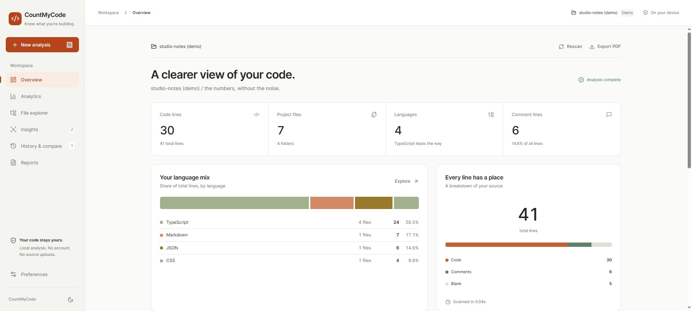
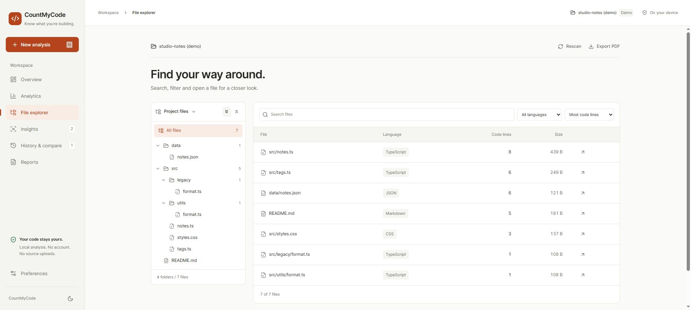
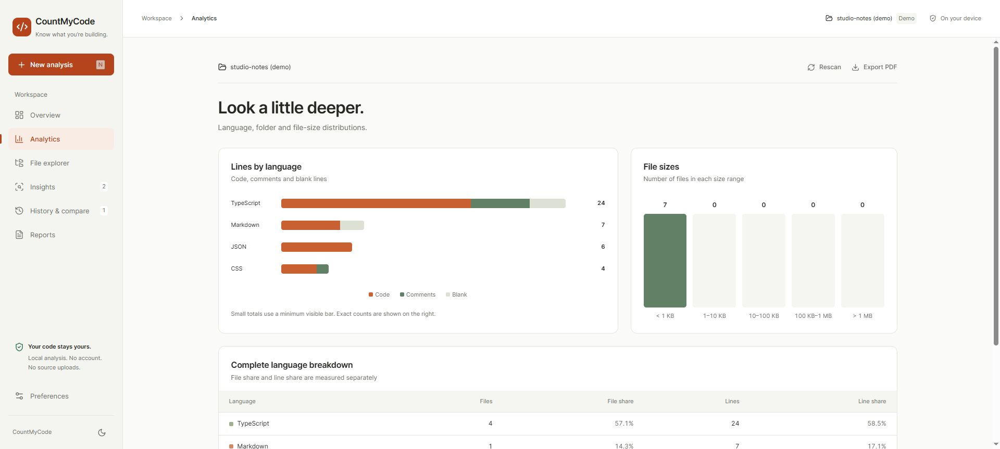

# CountMyCode

[](https://github.com/buildwithmehar/CountMyCode/actions/workflows/ci.yml)
[](LICENSE)

A browser-based repository workbench for understanding a codebase. Explore files, count code and comments, find duplicate content, and compare scans. Local source files stay on your device. No account, backend, or API key is required.



## Run locally

Use **Node.js 24** and npm. No environment variables are needed.

```sh
git clone https://github.com/buildwithmehar/CountMyCode.git
cd CountMyCode
npm ci
npm run dev -- --host 127.0.0.1 --port 5174
```

Open [localhost:5174](http://localhost:5174). Choose **Explore demo project** to scan the bundled example, or open your own project. Folder selection works best in desktop Chrome or Edge; ZIP import is an alternative when directory selection is unavailable.

## Included

- Orange/neutral responsive workspace with light, dark and system themes.
- Folder selection, folder drag/drop, ZIP import and public GitHub repository import.
- Worker-based file/line counts, consistent language colours, folder breakdown and size distributions.
- Collapsible folder/file tree with type icons, expand/collapse-all, virtualized rows, keyboard navigation and a read-only syntax-highlighted source drawer.
- TODO/FIXME/HACK/XXX comment markers, SHA-256 duplicate groups and explicit skip reasons.
- Up to 20 browser-local snapshots, restore/delete and two-scan or two-project comparisons.
- PDF summaries, spreadsheet-safe CSV file reports and complete JSON metadata exports.
- Root .gitignore/.omnicountignore and custom ignore patterns. Dependency/build exclusions remain active.
- Content-hash parsing cache during the current session. Rescans still read and hash content so changes cannot be missed because timestamps match.
- Keyboard shortcuts: Ctrl/Cmd+O opens a folder; N starts a new analysis outside input fields. Escape dismisses dialogs. Motion respects the system reduced-motion preference.

## Screenshots





## Deploy on Cloudflare

The app is static: build it with `npm run build` and publish **`dist`** over HTTPS. No server process or database is needed.

For **Cloudflare Pages Git integration**, connect this repository and use:

| Setting                           | Value                              |
| --------------------------------- | ---------------------------------- |
| Production branch                 | `main`                             |
| Framework preset                  | React (Vite)                       |
| Build command                     | `npm run build`                    |
| Build output directory            | `dist`                             |
| Root directory                    | Repository root                    |
| Node.js version                   | `24` (`NODE_VERSION=24` if needed) |
| Application environment variables | None                               |

Pages serves client-side routes through its default SPA fallback. See the [deployment guide](docs/deployment.md), including the Workers Static Assets option for new projects.

## Privacy and limits

Line classification is heuristic, not a full parser or a code-quality score; complex strings, docstrings and embedded languages may need manual review. Binary, oversized and unreadable files retain their file/byte totals and get zero counted lines. Ignored-entry totals count an excluded directory as one entry.

ZIPs are limited to 50 MB compressed, 150 MB expanded and 10,000 entries. GitHub import is public-only, up to 1,500 files / 50 MB, and depends on GitHub rate limits. Oversized or truncated repositories are rejected without saving a partial scan.

History uses IndexedDB and stores project names, relative paths, counts, hashes and comment-marker snippets, but not complete source files. Reopen the original project to preview a historical file. Preferences and themes use localStorage. Clearing browser data removes saved scans.

Local folder/ZIP analysis sends no source files over the network. Explicit GitHub imports fetch from `api.github.com` and `raw.githubusercontent.com`. Exports are created locally. Fonts are bundled with the app.

## Verify and contribute

```sh
npm run check
npm audit
```

`check` runs formatting, tests, TypeScript and the production build. GitHub Actions runs these checks and dependency auditing on pushes and pull requests. Use `npm run format` before contributing; see [CONTRIBUTING.md](CONTRIBUTING.md).

For reproducible scan timings, run `npm run benchmark`. See [performance notes](docs/scan-performance.md) for the measured workloads and limits.

## Project structure

```text
src/renderer/src/  React workspace, components, local history, PDF export
src/shared/        Parsing, languages, statistics, CSV, ignore rules
src/web/           Imports, traversal, worker pool, scan coordination
src/demo/          Bundled example project
tests/             Parser, import, scheduling, export and tree regressions
docs/              Screenshots, deployment guide and performance notes
```

## License

Copyright © 2026 Mehar Ali. Project code is available under the [MIT License](LICENSE). Third-party packages and fonts retain their own licenses; see [THIRD_PARTY_NOTICES.md](THIRD_PARTY_NOTICES.md).
