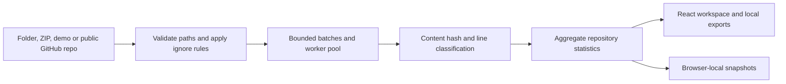

# Architecture and data flow

CountMyCode is a static React application. The web host serves compiled assets; it does not receive local project files or run repository analysis.

## From project to result

`src/web/omni.ts` coordinates file selection, settings, cancellation, progress, and scanning. Folder traversal reads root ignore files before walking excluded subtrees. ZIP imports validate paths and resource limits before producing source files. GitHub import explicitly fetches public files and rejects incomplete repository trees.

The worker pool groups files into batches bounded by file count and estimated bytes. Workers claim the next batch so a large file does not reserve a fixed share of the queue. Automatic worker selection avoids multiple workers for tiny projects and caps parallelism at eight workers.

Each worker reads and SHA-256 hashes content before checking its own parsing cache. A matching timestamp or size is insufficient to reuse a result. Reads and hashes are pipelined with a bounded concurrency estimate. Worker cancellation terminates active workers and rejects pending batches; a cancelled run must not replace the displayed result.

`src/shared/analytics.ts` aggregates file analyses into a `RepositoryStats` result. The interface renders that result before waiting for a history write. Progress notifications are throttled while phase changes and terminal states stay immediate.

## Parsing semantics

`src/shared/analysis.ts` classifies lines using language comment delimiters and simple string handling. LF, CRLF, and CR line endings are normalized; a terminal newline does not invent another line. A line containing code and a comment counts as code. Comment markers are collected from recognized comment text.

This is a heuristic, not a compiler or full language parser. Complex strings, docstrings, embedded languages, and language-specific escaping can require manual review. Binary, oversized, and unreadable files keep file/byte totals while skipping line counts.

## Storage and privacy

- Original source files are retained in the current browser session for analysis and read-only previews.
- IndexedDB stores up to 20 snapshots with counts, paths, hashes, and marker snippets. Full source content is not included in snapshots.
- Restoring a snapshot does not restore source previews. Users reopen the original project to read its files.
- localStorage contains theme and scan preferences. Saved scan settings are normalized before use and before writing.
- JSON and CSV exports are generated locally. PDF support is loaded when needed. Spreadsheet text fields are escaped and formula-like names are neutralized.

Snapshots and reports can still contain sensitive project names, paths, and snippets. See [SECURITY.md](../SECURITY.md) for reporting guidance and boundaries.

## Working on the code

| Area                          | Responsibility                                                                         |
| ----------------------------- | -------------------------------------------------------------------------------------- |
| `src/shared`                  | Pure parsing, statistics, settings normalization, ignore matching, CSV serialization   |
| `src/web`                     | File access, imports, traversal, workers, progress, cancellation                       |
| `src/renderer/src/components` | Workspace views, virtualized file tree, source drawer                                  |
| `src/renderer/src/lib`        | Browser history, presentation helpers, file-tree index, PDF export                     |
| `tests`                       | Parser and import behavior, scheduling, traversal, settings, exports, tree regressions |

Keep changes within the layer that owns the behavior. Use a focused regression test for a concrete failure, then run `npm run check`. Browser verification is still needed for visual changes, focus behavior, file picker permissions, and deployed routing. See [CONTRIBUTING.md](../CONTRIBUTING.md) and the [deployment guide](deployment.md).
